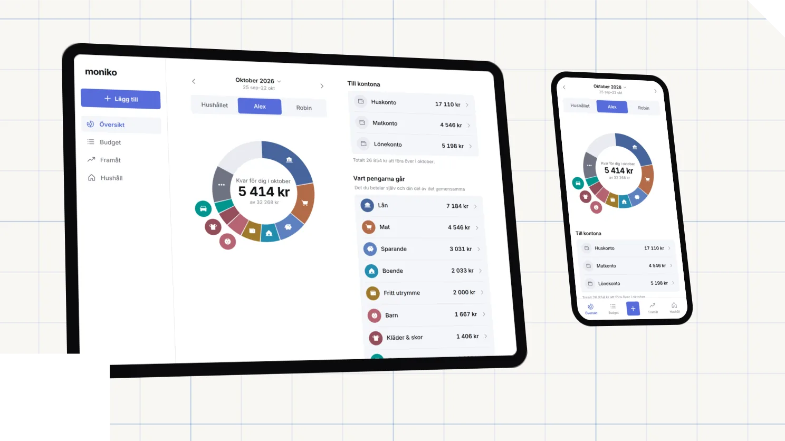
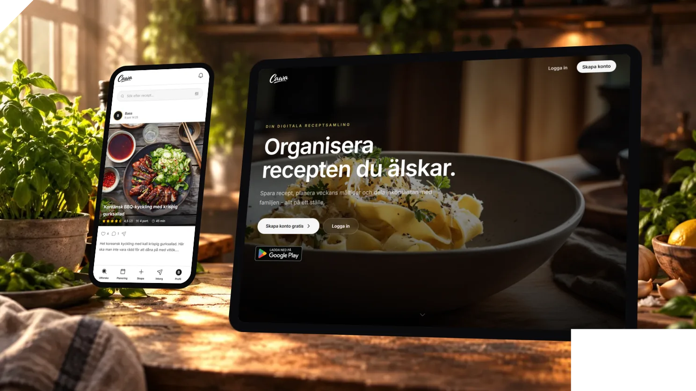
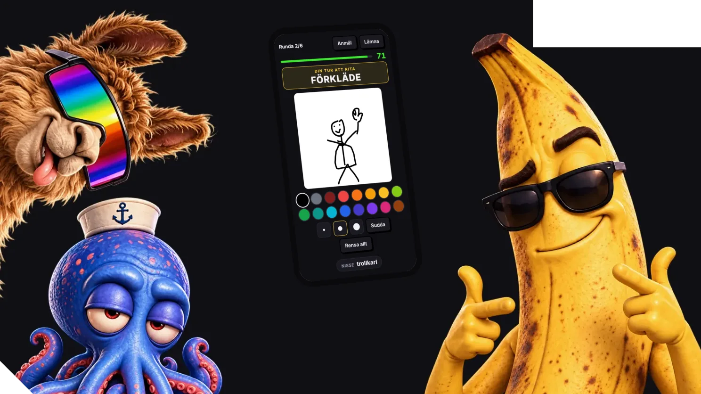

<a name="hero">
<picture>
  <source media="(prefers-color-scheme: dark)" srcset="assets/header-dark.svg">
  
</picture>
</a>

[calmarwebb.se](https://calmarwebb.se) · [LinkedIn](https://linkedin.com/in/sebastianvaldemarsson) · [Email](mailto:sebastian@calmarwebb.se)

<a name="about">
<picture>
  <source media="(prefers-color-scheme: dark)" srcset="assets/head-about-dark.svg">
  
</picture>
</a>

- Studying Fullstack Development at **Medieinstitutet**, right now: third-party integrations
- Founder of **Calmar Webb AB**, with three products live: Moniko, Cawa and Dorkus
- Product developer in the food industry, on leave while I study
- Off the clock: Home Assistant, cooking, renovating, gaming and family

<a name="featured">
<picture>
  <source media="(prefers-color-scheme: dark)" srcset="assets/head-featured-dark.svg">
  
</picture>
</a>

<a href="https://moniko.se">
<picture>
  <source media="(prefers-color-scheme: dark)" srcset="assets/moniko-dark.webp">
  
</picture>
</a>

<a name="moniko">
<picture>
  <source media="(prefers-color-scheme: dark)" srcset="assets/meta-moniko-dark.svg">
  
</picture>
</a>

### Moniko

A budget for yourself or the whole household. See what's left each month, where the money goes and how your finances develop over time. Built and run solo, live on the web.

`React` `TypeScript` `Supabase` `Tailwind CSS` `Stripe`

[Website](https://moniko.se)

 

<a name="cawa">
<picture>
  <source media="(prefers-color-scheme: dark)" srcset="assets/meta-cawa-dark.svg">
  
</picture>
</a>

### Cawa

Recipes, meal plans and shopping lists. A social recipe platform for the whole household. Save recipes, plan the week and share with friends. Built and run solo, live on the web and on Google Play.

`React` `TypeScript` `Supabase` `Tailwind CSS` `Capacitor`

[Website](https://cawa.nu) · [Google Play](https://play.google.com/store/apps/details?id=nu.cawa.app)

 

<a name="dorkus">
<picture>
  <source media="(prefers-color-scheme: dark)" srcset="assets/meta-dorkus-dark.svg">
  
</picture>
</a>

### Dorkus

A drawing party game for 2-8 players. No TV, no controllers: the phones are the game. One player has the app, everyone else joins from the browser.

`React` `TypeScript` `Cloudflare Workers` `WebSockets` `Capacitor`

[Website](https://dorkus.se) · [Google Play](https://play.google.com/store/apps/details?id=se.dorkus.app)

 

<a name="more-projects">
<picture>
  <source media="(prefers-color-scheme: dark)" srcset="assets/head-more-dark.svg">
  
</picture>
</a>

**[Nocturne](https://murder-mystery-rust.vercel.app)**: multiplayer murder-mystery game, built in a team of three with [Carolina](https://github.com/Carowa27) and [Steven](https://github.com/stevenlomon) · `Next.js` `Supabase`

**[HASP](https://github.com/csschef/hasp)**: a fast, mobile-first dashboard for Home Assistant · `TypeScript` `Web Components`

**[Vikingsås](https://chili-ehandel.vercel.app)**: online shop for chili sauces, a school project · `React` `Express` `PostgreSQL`
